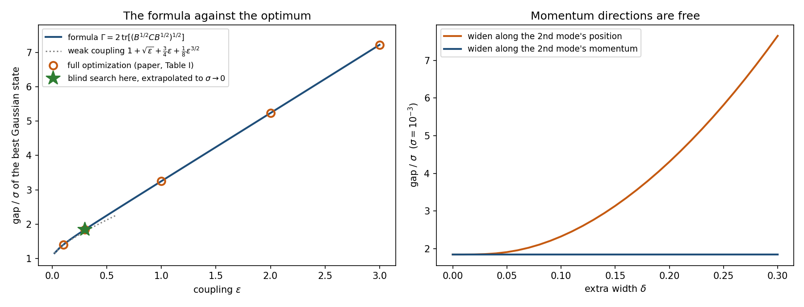

# resolution-gap-many-dof

[](https://doi.org/10.5281/zenodo.23370396)[](https://colab.research.google.com/github/neginyan/resolution-gap-many-dof/blob/main/demo/resolution_gap_many_dof.ipynb)
[](https://github.com/neginyan/resolution-gap-many-dof/actions/workflows/verify.yml) 

Code, results and verification for the paper

> T. Namba, *The resolution gap in many degrees of freedom*, preprint v1.0, Zenodo (2026),
> [doi:10.5281/zenodo.23371932](https://doi.org/10.5281/zenodo.23371932).

It continues two earlier papers:

- T. Namba, *A resolution gap for the coarse-grained arrow of time in nonlinear Hamiltonian flows*, preprint v1.1, Zenodo (2026),
  [doi:10.5281/zenodo.23320603](https://doi.org/10.5281/zenodo.23320603)
  (code: [resolution-gap-arrow-of-time](https://github.com/neginyan/resolution-gap-arrow-of-time)).
- T. Namba, *Sharp criterion for the coarse-grained arrow of time in Hamiltonian dynamics*, preprint v1.2, Zenodo (2026),
  [doi:10.5281/zenodo.23258135](https://doi.org/10.5281/zenodo.23258135).

## Question

A Hamiltonian flow is observed through a Gaussian window of width σ that coarsens at rate r. The coarse-grained entropy grows
if and only if r exceeds a critical rate R of the state, and for Gaussian states R ≤ κ, the largest symmetric strain rate of the flow.
In one degree of freedom the best Gaussian state stays below κ by a *resolution gap* 2√(2βκ) σ. This paper asks how the gap
depends on the number of degrees of freedom, for mechanical systems H = |p|²/2 + V(q).

## Results

- **Momentum directions are free** (proved). The averaged strain felt by a Gaussian state depends only on its spread in
  configuration space.
- **A matrix formula for the gap** (proved as an upper bound). The best Gaussian state has
  κ − R\* ≤ Γσ + O(σ²), with Γ = 2 tr[(B^½ C B^½)^½]. Here B is minus one half of the configuration-space Hessian of the strain
  along the most stretching direction, and C = diag(2κ, κ, …, κ).
  Uncoupled degrees of freedom cost nothing; a coupled one costs in proportion to how strongly the maximal strain depends on it.
- **Two coupled pendulums** (closed form). Γ = 1 + √ε + ¾ε + ⅛ε^{3/2} + O(ε²) for coupling ε.
- **The formula is the optimum** (observed; stated as a conjecture). Searches over all Gaussian states, assuming no shape, find the
  state the formula predicts. In thirteen systems the optimum agrees with Γ to a relative 4 × 10⁻⁸.
- **Predicted before computed.** Γ for chains of three and four pendulums and for a product coupling was written to a file with
  time and SHA-256 hash before any optimisation; all six predictions were confirmed.
- **Mixtures gain less in more dimensions** (observed). Mixtures of Gaussians, which beat the best Gaussian state in one degree of
  freedom, gain only 40–55 % as much in two at the same search effort, almost entirely by mixing in the plane of the most
  stretching mode. An empirical law for this reduction predicted two further couplings to within 6 %.

## Check it yourself in the browser



The notebook [`demo/resolution_gap_many_dof.ipynb`](demo/resolution_gap_many_dof.ipynb) checks four claims of the paper from scratch in
about two minutes on a CPU: Γ computed from the potential alone; a blind search over all Gaussian states (random means, random
4 × 4 covariance factors) that lands on Γ when extended to σ → 0; widening the optimal state along a momentum direction costs
nothing, along a position direction a lot; and the sealed predictions for pendulum chains, downloaded from this repository with their
hash checked and recomputed. [Open it in Colab](https://colab.research.google.com/github/neginyan/resolution-gap-many-dof/blob/main/demo/resolution_gap_many_dof.ipynb).

## Repository layout

| path | contents |
|---|---|
| `paper/` | LaTeX source (`main.tex`, `sections/`, `figures/`) |
| `study/` | numerical study, stages A–N: scripts, raw results (`results/`), logs, figures, stage summaries. Stages L–N are the work for this paper; stages A–K are those of the earlier paper, included so that the verification suite runs in one place. |
| `study/verification/` | verification suite: one script per stage and `run_all_stages.py` |
| `independent_checks/` | checks of the analytical statements, written separately from the study code |
| `demo/` | Colab notebook: the formula, a blind search, momentum directions, the sealed predictions |

`study/README.md` describes every stage and every script.

### Paper figures

| figure | file in `study/figures/` | made by |
|---|---|---|
| Fig. 1 (formula against the optimum) | `stageM_formula.png` | `study/m_analyze.py` |
| Fig. 2 (mixtures in one and two degrees of freedom) | `stageN_mix.png` | `study/n_analyze.py` |

### Sealed predictions

| prediction | file | SHA-256 (start) | written (UTC) |
|---|---|---|---|
| Γ for chains and a product coupling (Sec. V) | `study/results/m2_prediction.json` | `d84ba44a` (full hash in `study/logs/m2_prediction_hash.txt`) | 2026-10-13 00:46:28 |
| mixture gain for ε = 1 and −0.3 (Sec. VI) | `study/results/n1_prediction.json` | `96300c58` (full hash in `study/logs/n1_prediction_hash.txt`) | 2026-10-13 09:58:04 |

The scripts that test a prediction check its hash before they run, and the verification suite checks it again.

## Verify

```bash
pip install -r requirements.txt
cd study
python verification/run_all_stages.py     # 479 checks (stages A–N)
cd ../independent_checks
python check_paperC.py                    # 64 checks
```

Every check of the study suite states its tolerance and reports how much of it is used. Both the suite and the independent checks run on every push with GitHub Actions
(badge above).

## Use of AI assistants

This work was carried out with the help of AI assistants: Google Gemini, OpenAI ChatGPT and Anthropic Claude.
The author directed the research and takes full responsibility for it. All numbers are checked by the scripts in this repository.

## License

MIT (see `LICENSE`).
